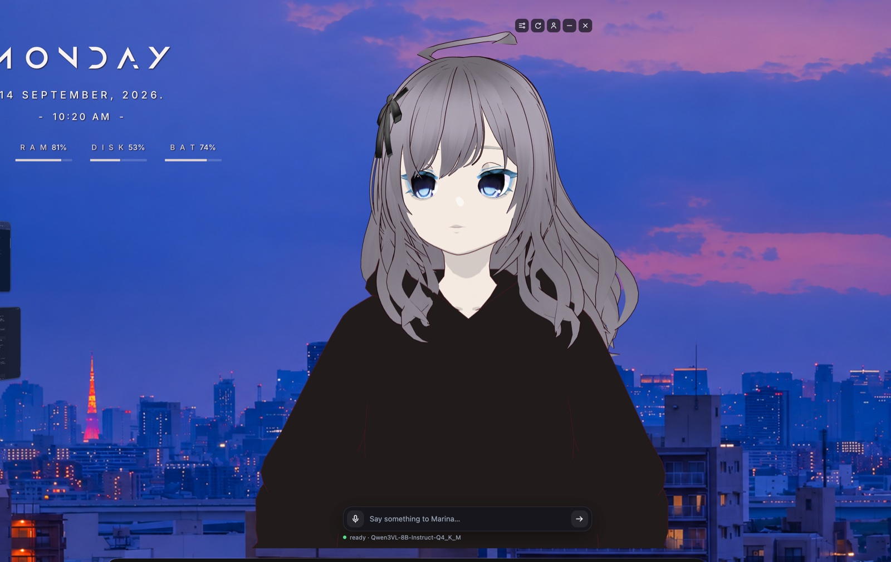

# Marina

Marina is an anime character who lives on your Linux desktop. She sits in a
transparent window that stays on top of everything else, and you can either
talk to her out loud or type. She answers in her own voice, lip syncs while
she does it, and acts out the little stage directions she writes.



It started as a fork of [rayenfeng/riko_project](https://github.com/rayenfeng/riko_project).
That project had the voice pipeline, but the avatar frontend was still an
unchecked TODO, so I built it and split things up so the language model can run
on a different machine.

Everything apart from the language model runs on your computer. The voice model
is local and uses about 674 MB of RAM.

## Platforms

| Platform | Status |
| --- | --- |
| Linux, x86_64, X11 | Supported. |
| Linux, x86_64, Wayland | Supported, with the limits under [Wayland](#wayland). She runs as an XWayland window. |
| Linux, aarch64 | The code has nothing x86-specific in it and `build-app.sh` builds for it, but it hasn't been tried. |
| macOS, Windows | Not supported. |

## Install

There is no prebuilt download. Either [run her from a checkout](#building-from-source),
or build one file you can keep:

```bash
./setup-linux.sh      # once
./build-app.sh        # makes app/dist/Marina-1.0.0-x86_64.AppImage
```

The AppImage carries its own Python, the voice model and the speech recognition
model, so nothing else needs setting up and it runs on a machine that has never
seen this repo. It is a big file, around 1 GB, because those models are inside it.

To run it, make it executable once and start it:

```bash
chmod +x app/dist/Marina-1.0.0-x86_64.AppImage
./app/dist/Marina-1.0.0-x86_64.AppImage
```

Run only one copy at a time: the AppImage and `./start-app.sh` both use port
8765, so whichever starts second fails with an error dialog.

Two things come from your distribution, not from the app. On **Debian 13 (trixie)**:

```bash
sudo apt install libportaudio2     # the microphone
sudo apt install libfuse2t64       # to run any AppImage; or run it with --appimage-extract-and-run
```

Package names differ between releases, so check yours. `libfuse2` is the name on Debian 12
and Ubuntu 22.04 and earlier, and `libfuse2t64` on Debian 13 and Ubuntu 24.04. For the
microphone it is `portaudio` on Fedora and Arch. To build from a checkout you also need
`python3-venv`, `npm` and `rsync` (`sudo apt install python3-venv npm rsync`).

Her small helpers, on Debian 13 (all optional; each switches a feature on):

| Feature | Package |
| --- | --- |
| Read the clipboard | `wl-clipboard` (Wayland) or `xclip` / `xsel` (X11) |
| Open links | `xdg-utils` (usually already there) |
| Look at the screen | `kde-spectacle` (KDE), `gnome-screenshot` (GNOME), `grim` (Sway, Hyprland) or `scrot` (X11) |
| Use the mouse and keyboard, Wayland | Nothing to install on KDE or GNOME: she uses the desktop's own RemoteDesktop portal (`xdg-desktop-portal` with its KDE or GNOME backend, which a desktop install already has). The first time she types or clicks the desktop asks you to allow it, and remembers your answer |
| Use the mouse and keyboard, X11 | `xdotool` |
| Mouse and keyboard on Wayland without the portal | `ydotool`, which **is not in Debian 13's repositories**: build it from [its source](https://github.com/ReimuNotMoe/ydotool). Its `ydotoold` daemon needs `/dev/uinput`, which is root-only by default |
| Tell which window is in front, KDE Wayland | `kdotool`, also not in apt |
| Stay above full-screen apps, KDE | `x11-utils` (for `xprop`) |

### Giving her a brain

Marina's voice, avatar, animation and speech recognition all run on your computer
and work the moment you open her. The language model is the one piece she can't
carry, because no model worth talking to fits in an app bundle.

By default she looks for [Ollama](https://ollama.com) on this computer:

```bash
ollama pull llama3.2:3b
```

That is enough. If Ollama isn't running she will say so in the app rather than
failing silently.

On a modest PC (tested on a dual-core i5 with no GPU and 8 GB of RAM) a 1.5B to
3B model runs, slowly: expect the first reply to take a minute or more while it
reads her prompt, and set `llm.timeout_seconds` to match. The smallest models
are poor at using tools. `qwen2.5:3b` reliably opened a named browser and site
when asked, and `qwen2.5:1.5b` does so less often. If she keeps describing a
task instead of doing it, clear the conversation first (the "Forget
conversation" button in the app, or `/reset` over Telegram): her own earlier
non-answers in the chat history make the next one more likely.

To point her somewhere else, pick **Edit config…** from her tray icon and
change `llm.base_url` and `llm.api_key`. Anything OpenAI-compatible works:
llama.cpp, LM Studio, vLLM, a box on your network, or OpenAI itself. Leave
`base_url` empty to use OpenAI.

Her config, memory and chat history live in `~/.config/Marina/` when she is
packaged, and in the checkout when you run her from one.

### Staying on top

She is meant to float above everything, on every desktop. How well that works
depends on the window manager, so here is what actually happens on KDE Plasma
(measured with KWin's own window information, not assumed):

- She runs as an X11 client, through XWayland on a Wayland desktop. A native Wayland
  window can't ask to stay on top, to be placed, or to be shaped like her, and
  Electron picks that backend before the app's own code runs, so it takes the
  flag `--ozone-platform=x11`. The AppImage and the unpacked build are started
  through a small launcher script that passes it; `./start-app.sh` (a development
  run) starts the app and has it restart itself once with the flag. Set
  `MARINA_WAYLAND=1` to run natively instead, if your compositor has no XWayland
  (she then loses always-on-top and her position).
- Why not native Wayland: it was tried on KDE Plasma 6.3 with Electron 44. The
  window is transparent and can be placed and kept above ordinary windows by a
  KWin script, but `setShape` and `setIgnoreMouseEvents` do nothing, so her whole
  rectangle would swallow clicks; a "keep above" window reaches KWin layer 3
  while an active full-screen app is on layer 5; and a forced window-type rule
  has no effect on Wayland windows. Only a layer-shell client can do these, and
  Electron isn't one. Revisit this if Electron gains layer-shell or input-region
  support, or if the window is rebuilt in GTK4 or Qt.
- An always-on-top window stays above every ordinary window, including maximized
  ones, but **KDE keeps an active full-screen app above even that**. To go over
  full-screen apps too, she marks her window as a critical notification, which
  is the layer KDE uses for things like the volume pop-up. This is on by default
  on KDE, and `xprop` has to be installed for it (`sudo apt install x11-utils`).
  Untick **Show over full-screen apps** in her tray menu to turn it off.
- The price: KDE won't move or resize a window of that kind, so the strip along
  her top edge moves her through the app instead. Typing, the tray and stage view
  are unaffected (stage view switches back to an ordinary window while it is full
  screen).
- She has a fixed size, and only her position is remembered between runs. On a
  screen with fractional scaling (105%, 125%, ...) X11 grows a window by a couple
  of pixels every time its position is set, so a restored or resized window
  creeps bigger each launch. Pinning the size and correcting the position by the
  measured offset keeps her where you left her.
- Other desktops: always-on-top works wherever the window manager honours the
  standard "above" hint. The full-screen option is KDE only.

What running through XWayland costs:

- The global shortcuts (Ctrl+Shift+H to hide, Ctrl+Shift+Space to talk,
  Ctrl+Shift+. to cut her off, Ctrl+Shift+F for stage view, Ctrl+Shift+Q to
  quit) may only fire while an XWayland window has focus. Everything is also in
  her tray menu, and the buttons are in the window.
- GNOME shows no tray icon without the AppIndicator extension. KDE, Xfce and
  Cinnamon do.
- The window is transparent, so it needs a compositing window manager. Every
  current desktop has one.
- If a packaged AppImage stops with a sandbox error, your distribution has
  restricted unprivileged user namespaces. Run it with `--no-sandbox`.

Letting her use your computer is described under
[What she can do](#what-she-can-do).

## Using her

**Talking.** Click the mic button, press **Space** (when you aren't typing in the
box), or press **Ctrl+Shift+Space** from anywhere. She stops listening when you
pause or after 10 seconds, and pressing the mic again ends it early. You can also
type in the box and press Enter. On modest hardware her first reply is slow, since
the model has to load and read her prompt: allow up to a minute, then replies
take a few seconds.

**In her window.** Move the pointer over her and buttons appear along the top:
choose the model and personality, let her use this computer (the monitor
icon, lit when it is on), forget the conversation, choose a different
`.vrm` avatar, hide her, quit. Along the bottom are the mic, the text box and
send, and a status line you can click to change the model or personality. The
"look at my screen" button only shows if `vision` is on in the config.

**Her tray icon** (right-click it):

- **Hide Marina / Show Marina**
- **Let her speak first**: turns her unprompted comments on or off
- **Show over full-screen apps** (KDE): see [Staying on top](#staying-on-top)
- **Let her use this computer**: off by default; the entry says "needs setup" until
  the tools it needs are installed
- **Listen for "Marina"**: the hands-free wake word
- **Personal mode / Presentation mode**: the presentation mode has no personal
  memories and its own conversation
- **Stage view (full screen)**: large subtitles, for turning the laptop round
- **Change model…**, **Reset position**, **Reload**
- **Edit config…** and **Open bridge log**
- **Quit Marina**: closes her and her bridge

**Shortcuts**, which work from any app while she is running:

| Keys | Does |
| --- | --- |
| Ctrl+Shift+Space | talk to her |
| Ctrl+Shift+H | hide or show her |
| Ctrl+Shift+F | stage view |
| Ctrl+Shift+. | cut her off mid-sentence |
| Ctrl+Shift+Q | quit |

They are grabbed through X11, so they only fire while an X11 (XWayland) window has
focus. A native Wayland window in front won't pass them on. The tray menu always
works. If another program wants one of these combinations (browsers use
Ctrl+Shift+Q, for one) the shortcuts are registered in `app/main.js`.

**Moving her.** Drag the strip along her top edge. She has a fixed size, and
where you leave her is remembered for next time. **Reset position** in the tray
puts her back near the top left of the screen.

## What she can do

- Sit on your desktop in a transparent, always-on-top window
- Talk to her or type. The mic stops by itself when you finish talking,
  or after 10 seconds
- Say her name to talk to her hands-free: "Marina, what time is it?" Off
  by default; turn it on with "Listen for Marina" in the tray menu. What the
  mic hears is transcribed on your computer and thrown away unless it is said to
  her
- Starts speaking before the whole reply has been generated
- You can cut her off by talking over her
- Sometimes says something without being asked
- Timers, reading the clipboard, opening links, remembering things. The
  clipboard needs `wl-clipboard` (Wayland) or `xclip` or `xsel` (X11), and
  links need `xdg-open`
- Has her own Linux machine where she runs commands and edits code, so you
  can build things with her instead of just talking about them
- You can text her on Telegram, voice notes included, and she texts you
  first now and then
- Knows what day and time of day it is
- Can look at your screen when you ask (off by default)
- Can use your computer when you let her, from the monitor button in her window,
  "Let her use this computer" in the tray menu, or the model picker: see the screen, open apps, click and type, run commands, and
  edit files in your home folder. She asks first before using the mouse and
  keyboard and before anything risky, and your passwords and keys are off
  limits. It needs a screenshot tool (`spectacle`, `gnome-screenshot`, `grim`
  or `scrot`) and Pillow, and for the mouse and keyboard the RemoteDesktop
  portal on Wayland (the desktop asks you once), `xdotool` on X11, or `ydotool`
  as a fallback. Through the portal she can only type characters your keyboard
  layout has: others such as accented letters, euro signs or emoji may be
  skipped, and she tells you when the text had any. Wayland won't say
  which window is in front, so there she can't check she isn't typing into a
  password manager; with `kdotool` on KDE she can. The tray menu says
  "needs setup" until the tools are there. The portal's permission is kept in
  `~/.config/Marina/portal_token`; delete that file and turn the permission off
  in your desktop's settings to take it back
- Lip sync with five mouth shapes
- A presentation mode for showing her to people: a poised personality, no
  personal memories, and its own conversation. Switch from the menu on her
  status line
- Stage view (Ctrl+Shift+F): full screen with large subtitles, for turning the laptop
  round at an event
- Hair physics, blinking and eye movement
- `*actions*` in her replies play as animations instead of being read out
- Long-term memory
- Local voice (Kokoro) and speech recognition (Faster-Whisper)
- Works with any OpenAI-compatible model: Ollama, llama.cpp, LM Studio, vLLM
  or OpenAI itself

## Texting her

Telegram is how she lives on your phone. It's a real chat: she shows as
typing, splits what she says into separate texts, answers a voice note with
a voice note in her own voice, and every so often messages you first.
Timers you set while texting go off as texts.

1. Message [@BotFather](https://t.me/BotFather), send `/newbot` and copy the
   token it gives you.
2. In the config of an always-on bridge, set `telegram.enabled: true` and
   paste the token into `telegram.token`. Restart the bridge.
3. Message your bot. It replies with your chat id. Put that in
   `telegram.owner_chat_id` and restart again.

Only that chat can talk to her; anyone else just gets told their chat id.
`/reset` clears the conversation and `/quiet` stops her texting first until
`/unquiet`. Run this on one bridge only, because two bridges polling the same
bot steal each other's messages. Mine runs on the server next to her model,
so she can text me when my desktop is asleep.

## Her own machine

Give her a Linux box (mine is a Debian VM) and she can actually do things on
it: run commands, read and edit files, build and test code. Ask her to make
you something and she will write it, run it, fix what breaks and tell you how
it went. You can SSH into the same machine and pick up where she left off.

She can see it too: `look_at_desktop` screenshots the machine and shows
it to her model, so after changing a theme she looks at the result instead
of guessing. That needs a model that takes images; for llama.cpp, start it
with the model's `--mmproj` file.

Mine has a desktop as well (XFCE, reached over RustDesk), and logging in
opens the terminal we share: `marina-tmux`, a tmux session where her
commands scroll past in the top pane as she runs them and the bottom pane is
mine. If I tell her to look at an error, she reads my pane. Over SSH it is
`ssh -t marina@<host> marina-tmux`. The script is in
[`server/workspace/marina-tmux`](server/workspace/marina-tmux); copy it to
`/usr/local/bin` on the machine.

She gets in with an SSH key of her own, so she can do exactly what that
account can do, and taking it away is deleting one line from its
`authorized_keys`. See `workspace:` in the config. Give her a machine you
don't mind her breaking. The presentation preset turns it off so guests
can't talk her into running things.

## Running her brain on a server

The bridge runs fine headless on Linux, which is how the Telegram side stays
up. Mine is a Proxmox container with llama.cpp built for Vulkan, serving
Qwen3.6 35B-A3B on a Ryzen 7 255's Radeon 780M iGPU. That model is a
mixture of experts with only 3B parameters active per token, so it holds a
conversation at a decent pace on hardware with no graphics card.

```bash
cmake -B build -DGGML_VULKAN=ON && cmake --build build -j --target llama-server
llama-server -m Qwen3.6-35B-A3B-UD-Q4_K_M.gguf --alias marina -ngl 999 -c 65536 -np 2 -fa on --jinja
```

The 780M only gets the RAM the kernel lets it map, so raise that with
`amdgpu.gttsize=20480 ttm.pages_limit=5242880` on the kernel command line.
The headless bridge needs `libportaudio2` and `libsndfile1` and the same
`server/requirements-linux.txt`, and runs with `MARINA_ROOT` pointing at the
code and `MARINA_DATA` at a writable folder for its config and memory.

## Privacy

- The clipboard tool sends whatever is on your clipboard to the model, so it's
  only as private as your LLM endpoint. Turn it off with `tools.clipboard`.
- Looking at your screen sends a screenshot to the model, with the same caveat.
- Texting goes through Telegram's servers, and bot chats are not end-to-end
  encrypted, so anything you text her, voice notes included, is readable by
  Telegram. The voice notes are transcribed and spoken on your own bridge,
  not by Telegram, but the audio still passes through them.
- `asr.offline: true` stops Faster-Whisper checking Hugging Face for model
  updates every time it loads.

The bridge only listens on `127.0.0.1`, so nothing else on your network can
reach it.

## Building from source

You only need this if you want to change her, or to run her without packaging.

### 1. Set up

```bash
./setup-linux.sh
```

This finds or installs Python 3.12 (3.10 or newer works), creates `.venv`, installs
the dependencies, downloads the Kokoro voice model and installs the app's npm
packages. It's fine to run it more than once. It tells you at the end which
system packages are missing, such as PortAudio.

### 2. Configure

```bash
cp character_config.example.yaml character_config.yaml
```

The real config is gitignored because it holds your API key. Open it and change
whatever you need. If you skip this step the app writes the defaults out for you
on first run.

```yaml
llm:
  base_url: "http://127.0.0.1:11434/v1"   # your server, leave empty for OpenAI
  api_key: "ollama"                       # ignored locally but must be set
  model: "llama3.2:3b"

presets:
  default:
    system_prompt: |
      You are a helpful assistant named Marina.
      You speak like a snarky anime girl.

tts:
  provider: kokoro          # local, or 'sovits' for a remote GPT-SoVITS
  kokoro:
    voice: "af_heart"       # GET /voices lists all 54
```

### 3. Add your avatar

Add a `.vrm` file at `app/models/model.vrm`, or pick one with the model button
in the app. `.vrm` files are gitignored, so a fresh clone doesn't have one.

**VRoid Studio `.vroid` files won't work.** That's a project file with a
proprietary binary inside, not a 3D model. In VRoid Studio go to Export > VRM
instead. Her animation is tuned for **VRM 1.0**. A VRM 0.x export still loads, but its
bone axes are mirrored, so her arms come up instead of down and her nods and head tilts
go the wrong way. Pick VRM 1.0 in the export options.

A model to start with: [Seed-san](https://github.com/vrm-c/vrm-specification/tree/master/samples/Seed-san)
by VirtualCast, Inc., a VRM 1.0 sample under the VRM Public License 1.0 (use, modification and
redistribution allowed, credit required).

### 4. Run

Two terminals, no packaging step:

```bash
./start-bridge.sh     # the Python side with the mic, Whisper, your LLM and the voice
```

```bash
./start-app.sh        # the avatar
```

### 5. Package it

```bash
./build-app.sh
```

This downloads a relocatable Python 3.12, installs the backend's dependencies
into it, pulls the Whisper model, copies in the Kokoro voice and the avatar, and
hands the lot to electron-builder. Out comes `app/dist/Marina-1.0.0-x86_64.AppImage`.

The first run takes a few minutes and about 1.5 GB of disk. After that the
Python tarball is cached in `app/build/cache/`.

Nothing in the bundle points back at this folder, so the AppImage works on a
machine that has never seen the repo. That wasn't true before: the app used to record the
absolute path of the checkout at build time and load the venv out of it.

## Microphone

Linux doesn't ask for microphone permission. She records through PortAudio,
which uses whatever PipeWire or PulseAudio calls the default input. To use a
different one, set `asr.input_device` in the config to part of its name. A
Bluetooth headset switches into call mode when its mic is opened, which cuts
off her voice, so name another input if you wear one.

If the microphone doesn't work, check that `libportaudio2` is installed.

## Known limits

What doesn't work, or only partly, so you aren't surprised:

**Typing and clicking**
- On Wayland the mouse and keyboard go through the desktop's RemoteDesktop
  portal. It only types characters your keyboard layout has: accented letters,
  €, other alphabets and emoji are silently dropped by KDE. She names those
  characters in her reply so she can tell you, but she can't type them.
- The portal asks for permission the first time she types or clicks. If you
  say no, she can't use the mouse or keyboard until you remove
  `~/.config/Marina/portal_token` and allow it again.
- Wayland won't tell her which window is in front, so on KDE Wayland without
  `kdotool` she can't check she isn't typing into a password manager or a
  password prompt. Those checks work on X11, and on KDE Wayland with
  `kdotool` installed (it isn't in Debian's repositories).
- Scrolling through the portal turns the wheel under the pointer, so point at
  the window first.
- Without the portal, `ydotool` needs a daemon and access to `/dev/uinput`,
  and it isn't packaged for Debian 13.

**Her window**
- She runs through XWayland, not as a native Wayland window, and that is
  deliberate. A native Wayland Electron window can't be shaped to her, so it would
  block clicks across its whole rectangle, and it can't stay above full-screen
  apps. See [Staying on top](#staying-on-top) for what was measured.
- Showing over full-screen apps works on KDE only.
- The global shortcuts only fire while an XWayland window has focus; the tray
  menu and the buttons in her window always work.
- Only one copy can run at a time: the app and `./start-app.sh` both use port
  8765.

**Her brain**
- Small models (1.5B) often talk about doing something instead of doing it,
  and their own earlier non-answers in the chat history make that worse. The
  3B model is better at it and takes about a minute per reply on a laptop with
  no GPU. Clear the conversation with the "Forget conversation" button if she
  gets stuck.
- Memory keeps lasting facts about you, not one-off requests, but a small model
  can still miss one or note something wrong. `memory.json` is plain text you
  can edit.

**Texting her on Telegram**
- Her requests were checked against Telegram's published Bot API, and the
  whole loop (texts, voice notes in and out, rate limits, errors) is tested
  against a local stand-in for it, plus one live request with a made-up token
  to confirm the service is reachable and its refusal is handled. It hasn't
  been run with a real bot, because that needs your token. To try it: make a bot
  with @BotFather, put its token in `telegram.token`, set `telegram.enabled`,
  message the bot once to get your chat id, and put that in
  `telegram.owner_chat_id`. Run it on one bridge only.
- Voice notes need `soundfile` with Opus support, which the packaged app has.

**Everything else**
- macOS and Windows aren't supported.
- On GNOME there is no tray icon without the AppIndicator extension.
- `start-app.sh` and the AppImage have been tested on KDE Plasma 6.3 on Debian
  13 only; other desktops should work but haven't been tried.

## Layout

```
character_config.yaml         personality, LLM endpoint, voice
memory.json                   the facts she remembers (readable, editable)
server/
  marina_server.py            local HTTP bridge the app talks to
  main_chat.py                terminal only client (no avatar)
  requirements-linux.txt      slim client deps
  process/
    config.py                 shared config loader
    asr_func/                 Faster-Whisper and the microphone recorder
    asr_func/vad.py           hearing you over her own voice, for barge in
    llm_funcs/llm_scr.py      chat completions client, streaming, tool calls
    text_func/speech.py       splits replies into speech and animation cues,
                              and into speakable chunks while streaming
    idle.py                   when she says something unprompted
    tools/context.py          time, frontmost app, battery
    tools/session.py          X11 or Wayland, and the small tools that ask the desktop things
    tools/registry.py         timers, clipboard, links, remembering
    tools/computer.py         screen, mouse, keyboard, commands and files on your computer
    tools/portal.py           mouse and keyboard on Wayland, through the desktop's RemoteDesktop portal
    tools/workspace.py        commands and files on her own machine, over SSH
    telegram.py               texting her, voice notes, texting first
    vision/look.py            screenshot to vision model
    memory/store.py           durable facts, deduped and capped
    memory/extract.py         decides what is worth remembering
    tts_func/engine.py        picks the voice backend (kokoro or sovits)
    tts_func/sovits_ping.py   GPT-SoVITS HTTP client
models/kokoro/                local voice model (about 340 MB)
app/
  main.js                     Electron, the transparent always on top window
  preload.js                  IPC bridge
  renderer/app.js             three.js and three-vrm, lip sync, chat UI
  models/model.vrm            your avatar
  test/                       Electron scripts that load the avatar and check it
  build/backend/              staged by build-app.sh, copied into the bundle
```

Inside the packaged app the same pieces sit like this:

```
resources/                    (inside the AppImage)
  backend/python/             relocatable CPython 3.12 and the deps
  backend/server/             the Python source above
  backend/models/kokoro/      the voice
  backend/models/whisper/     speech recognition
  backend/character_config.example.yaml
  app.asar                    the Electron side and the avatar
```

Anything she writes goes to `~/.config/Marina/`: the config,
`memory.json`, `chat_history.json` and `bridge.log`. The bundle itself stays
read-only. `MARINA_ROOT` and `MARINA_DATA` are what tell the Python side which
is which; without them it falls back to the repo, which is what happens when you
run from a checkout.

While the bridge is running there are API docs at `http://127.0.0.1:8765/docs`.

## Credits

Built on top of **[rayenfeng/riko_project](https://github.com/rayenfeng/riko_project)**,
which had the original terminal voice chat pipeline. The avatar app and
everything around it is new here.

**Avatar and rendering**
- [three-vrm](https://github.com/pixiv/three-vrm) for the VRM rig, expressions and spring bones
- [three.js](https://threejs.org) and [Electron](https://www.electronjs.org)
- [VRoid Studio](https://vroid.com/en/studio), where the character was made
- [Seed-san](https://github.com/vrm-c/vrm-specification/tree/master/samples/Seed-san) by
  VirtualCast, Inc., the sample avatar used for testing the Linux port

**Speech**
- [Faster-Whisper](https://github.com/SYSTRAN/faster-whisper) for speech recognition
- [Kokoro-82M](https://huggingface.co/hexgrad/Kokoro-82M) through
  [kokoro-onnx](https://github.com/thewh1teagle/kokoro-onnx) for the voice
- [soxr](https://pypi.org/project/soxr/) for the pitch shift that keeps timing intact

**Language model**
- [Ollama](https://ollama.com), or any OpenAI compatible endpoint

**Optional**
- [GPT-SoVITS](https://github.com/RVC-Boss/GPT-SoVITS) as a voice cloning backend

MIT licensed.
